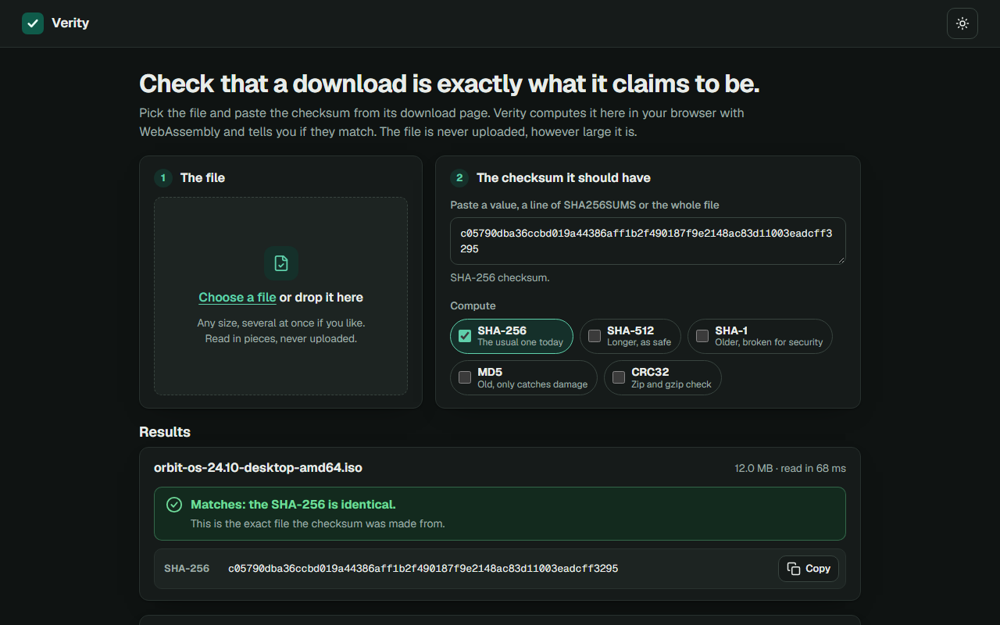

# Verity



Verity checks a download's checksum (its hash) to tell you the file is exactly the one its publisher released. Pick
the file, paste the checksum from the download page, and Verity tells you whether they match. The checksums are
computed in your browser by a 6 KB WebAssembly module, so the file is never uploaded, however large it is.

- **SHA-256, SHA-512, SHA-1, MD5 and CRC32**, computed in one pass over the file, as many as you pick.
- **Paste what the download page gives**: a bare value, a labelled value (`SHA-256: <hex>`), a line of `SHA256SUMS`
  (`<hex>  name`), a BSD line (`SHA256 (name) = <hex>`) or a whole sums file. The algorithm is found from the value,
  and with several lines each file is matched by its name. Choosing or dropping a small sums file (`SHA256SUMS`,
  `*.sha256`, `checksums.txt` …) fills the checksum in for you; any other file is checked.
- **Any size**: the file is read in 4 MiB pieces in a Web Worker, with progress, speed and time left.
- **A clear answer**: "Matches" or "Does not match" with where the values first differ, or why nothing was compared
  (for example, none of the pasted lines names the file). Copy any checksum in one click.
- **Text too**: type or paste text to hash it with the same picks and compare it with a pasted checksum.
- Light and dark themes, keyboard and screen-reader friendly, works from 360 px wide.

Nothing is sent anywhere and nothing is stored except the theme choice (`localStorage`, key `verity:theme`).

Screenshots: [dark theme](docs/screenshot-dark.png), [light theme](docs/screenshot-light.png).

## Run, test, lint and build

Node 22.12 or later (`^22.12.0 || ^24.0.0 || >=26`).

```sh
npm ci
npm run dev        # builds verity.wasm, then starts the development server
npm test           # the wasm against FIPS 180-4 / RFC 1321 vectors and Node, the parser, the verdicts and the page
npm run lint       # oxlint (.oxlintrc.json), warnings fail
npm run typecheck  # tsc --noEmit
npm run build      # verity.wasm + type check + production build in dist/, the folder that is served
npm run bench      # how fast verity.wasm hashes on this machine
```

## Speed

`npm run bench` feeds 256 MiB to `verity.wasm` in 4 MiB pieces, as the page does. Node runs WebAssembly on V8, the
engine of Chrome and Edge, so the page reaches about the same speed there, minus the time to read the file. Measured
on an x64 PC with Node 24.15:

| Algorithm      | Speed    |
| -------------- | -------- |
| CRC32          | 340 MB/s |
| MD5            | 310 MB/s |
| SHA-1          | 195 MB/s |
| SHA-256        | 150 MB/s |
| SHA-512        | 225 MB/s |
| All five at once | 45 MB/s |

Each algorithm picked adds its own time, so pick only the ones the download page gives (SHA-256 alone by default).

## How it works

- `assembly/` is the hashing core in [AssemblyScript](https://www.assemblyscript.org/), with no runtime and no
  imports beyond `abort`: one module per algorithm written from its specification (`crc32.ts`, `md5.ts` from RFC 1321,
  `sha1.ts`, `sha256.ts` and `sha512.ts` from FIPS 180-4), the block buffering and padding they share (`blocks.ts`),
  and `index.ts`, the interface the page uses. The page writes each 4 MiB piece into the module's memory and calls
  `update`; `finish` pads and writes the digests. `testing.ts` exposes the padding to the tests only
  (`build/testing.wasm`, never shipped).
- `assembly/constants.ts` is generated by `npm run constants` (`scripts/gen-constants.mjs`), which derives the round
  constants from their mathematical definitions.
- `src/hash.worker.ts` reads the file and drives the module through `src/wasm.ts`; `src/algorithms.ts` reads pasted
  checksums and recognises sums files; `src/verdict.ts` decides and words the answer; `src/main.ts` is the page.
- `icon.svg` is the app's icon, used both for listings and as the page's favicon.

MD5 and SHA-1 still catch damaged downloads, but they are broken against deliberate tampering: prefer SHA-256 or
SHA-512 when the publisher gives one.

## Licences

Verity is MIT licensed, © 2026 iSquare Lab: see [LICENSE](LICENSE).

- Geist and Geist Mono fonts (bundled from `@fontsource-variable`): SIL Open Font License 1.1.
- Icons adapted from [Lucide](https://lucide.dev/): ISC License.
